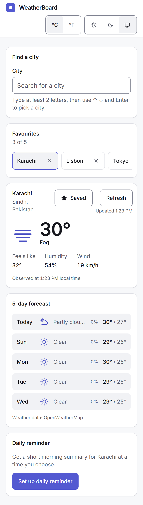
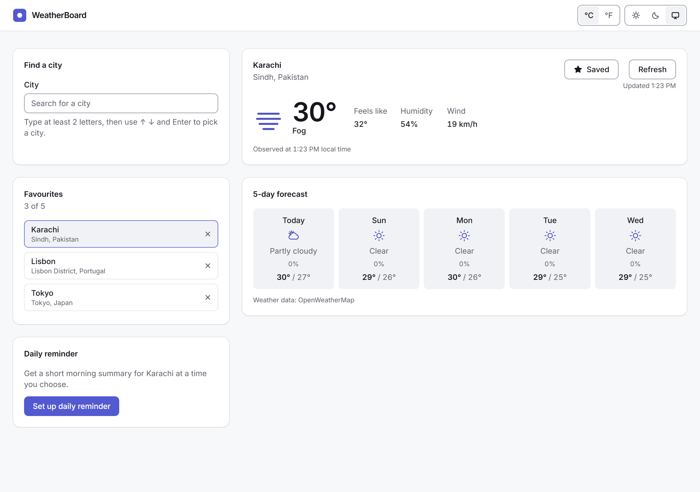
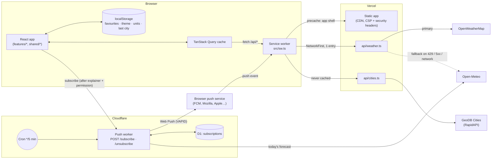
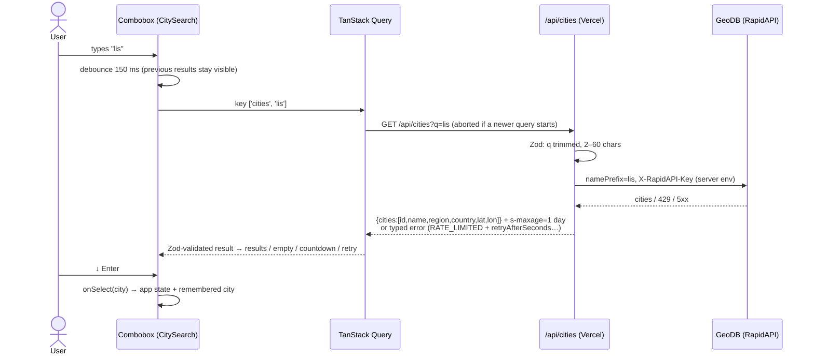
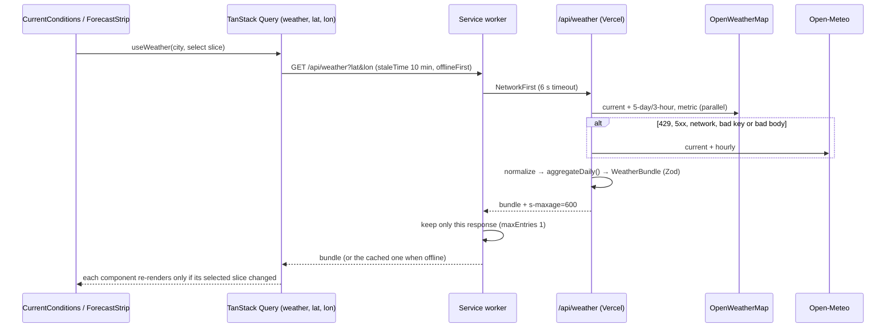
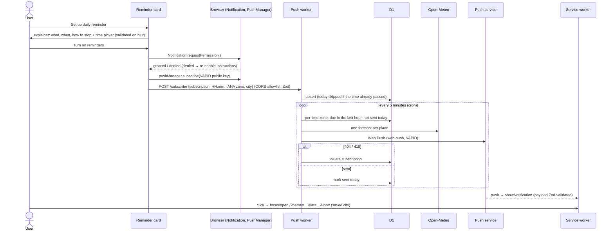

# WeatherBoard

An installable weather dashboard: city search with autocomplete, current conditions and a 5-day
forecast, favourites, offline support and daily push reminders. Built with Vite, React 19 and
strict TypeScript; API keys stay server-side in Vercel Functions and a Cloudflare Worker.

**Live:** <https://weather-board-project.vercel.app>

| 375 px                                                           | 1280 px                                                            |
| ---------------------------------------------------------------- | ------------------------------------------------------------------ |
|  |  |

Dark theme at 1280 px: [docs/screenshots/weatherboard-1280-dark.png](docs/screenshots/weatherboard-1280-dark.png).
Screenshots are of the live site with real data (three cities saved as favourites, the
**Daily reminder** card ready to set up), taken on 2026-11-14.

> **Production:** Vercel's production branch is `main` (promoted `dev` → `prod` → `main`).
> Weather comes from OpenWeatherMap, and daily push reminders are live through the Cloudflare
> Worker — verified end to end on 2026-11-14 (see [Testing strategy](#testing-strategy)).

## Contents

1. [Features](#features)
2. [Architecture](#architecture)
3. [Folder structure](#folder-structure)
4. [Data flow](#data-flow)
5. [Deliberate deviations](#deliberate-deviations)
6. [Rendering and performance](#rendering-and-performance)
7. [Security](#security)
8. [Testing strategy](#testing-strategy)
9. [Git and branching workflow](#git-and-branching-workflow)
10. [APIs and rate limits](#apis-and-rate-limits)
11. [Setup and environment variables](#setup-and-environment-variables)
12. [Known limitations](#known-limitations)

## Features

The requirement documents aren't in this repository; the numbering below follows the prompts
that introduced each feature (see [PROMPTS.md](PROMPTS.md)). Requirements 03 and 07 were never
named explicitly — they are mapped to the design-system/shell and hardening work.

| #   | Requirement                          | What it does                                                                                                                                                                                                                                                                      |
| --- | ------------------------------------ | --------------------------------------------------------------------------------------------------------------------------------------------------------------------------------------------------------------------------------------------------------------------------------- |
| 01  | City search                          | Accessible combobox (ARIA combobox/listbox, `aria-activedescendant`, ↑ ↓ Enter Escape, click outside), 150 ms debounce, abortable requests, previous results kept while typing; idle, loading, results, no results, rate-limited (auto-retry countdown) and network-error states. |
| 02  | Weather display                      | Current conditions + 5 daily entries aggregated from 3-hour slots; OpenWeatherMap with Open-Meteo fallback behind one contract; skeletons; offline, rate-limited, not-found and server errors each with a recovery action; throttled refresh; last city remembered.               |
| 03  | Responsive, accessible design system | Token-based light/dark palette (AA contrast), Inter self-hosted, primitives (Button, Input, Card, Banner, Dialog with focus trap, Skeleton…), 1 / 2 / 12-column grid at 375 / 768 / 1280, 44 px touch targets, visible focus, skip link.                                          |
| 04  | Favourites                           | Up to 5 cities, duplicates refused, cross-tab sync, Zod-checked storage with in-memory fallback and a dismissible notice; chips on phones, sidebar on desktop; confirm-to-remove with sensible focus; weather prefetched on hover/focus.                                          |
| 05  | PWA and offline                      | Installable (manifest, maskable icon, custom install button), update toast, app shell precached, last viewed city's weather cached (NetworkFirst, 1 entry) and shown offline with its age.                                                                                        |
| 06  | Push reminders                       | Daily forecast notification at a chosen local time: explainer before the permission prompt, Cloudflare Worker + D1 + cron, expired subscriptions removed, clear fallbacks for denied/unsupported/iOS.                                                                             |
| 07  | Quality and hardening                | 150 kB initial-JS budget, lazy loading, React Profiler audit, responsive + axe suite at three widths, secrets scan, strict CSP and security headers, Core Web Vitals in CI.                                                                                                       |
| B1  | Theme                                | Light / dark / system (default), follows OS changes, persisted, applied before first paint by a same-origin script (no inline script, CSP stays strict).                                                                                                                          |
| B2  | Units                                | °C/°F with km/h ↔ mph, persisted; converted at render time from metric data — no refetch, no reload.                                                                                                                                                                              |
| B3  | Animated icons                       | Inline SVG + CSS (rotating sun rays, drifting clouds, rain, snow, fog), transform/opacity only, paused offscreen, off under reduced motion. No Lottie (bundle size).                                                                                                              |

## Architecture



## Folder structure

```text
├─ api/                         Vercel Functions (Web signature) — server-only keys live here
│  ├─ cities.ts                 GET /api/cities  → GeoDB proxy
│  ├─ weather.ts                GET /api/weather → OpenWeatherMap, Open-Meteo fallback
│  └─ _lib/                     handlers, provider adapters, daily aggregation (+ tests)
├─ src/
│  ├─ app/                      entry, providers, shell, layout, last-city, Profiler regions
│  ├─ features/
│  │  ├─ search/                combobox, debounced query, rate-limit countdown
│  │  ├─ weather/               query + selectors, CurrentConditions, ForecastStrip, icons
│  │  ├─ favorites/             external store, toggle, quick-access panel
│  │  ├─ pwa/                   install prompt, update toast, offline banner
│  │  ├─ push/                  support detection, explainer dialog, reminder card
│  │  └─ settings/              theme store, units context, header controls
│  ├─ shared/
│  │  ├─ api/                   Zod contracts shared with api/ (cities, weather, errors)
│  │  ├─ hooks/                 useDebouncedValue, useOnlineStatus, useCountdown
│  │  ├─ lib/                   env, safe storage, units, cn
│  │  └─ ui/                    design-system primitives
│  ├─ sw.ts                     service worker (precache, runtime cache, push handlers)
│  └─ test/                     test setup and fixtures (fixtures live only here)
├─ worker/                      Cloudflare Worker (own package.json, wrangler.toml, D1 migration)
├─ e2e/                         Playwright specs + shared fixtures
├─ public/                      icons (generated), theme-init.js, favicon
├─ scripts/                     icon generation, bundle budget, secrets scan, vercel config, prompt log
├─ vercel.template.json         headers + CSP with origin placeholders → rendered to vercel.json
├─ CLAUDE.md                    project rules for the coding agent
└─ PROMPTS.md                   every prompt that built this project, annotated
```

Features import from `shared/` and from each other's `index.ts` only; `shared/` never imports
features. `src/shared/api/*-contract.ts` is compiled for both the browser and Node, so the client
and the Vercel Functions validate against the very same Zod schemas.

## Data flow

### Search



### Weather



### Push reminder



## Deliberate deviations

The app is not a pure static SPA calling public APIs directly. Two server pieces were added on
purpose:

**1. Vercel Functions as an API proxy (`api/cities.ts`, `api/weather.ts`).**

- **Keys stay secret.** RapidAPI and OpenWeatherMap keys would be public in a client bundle.
  The functions read them from server-only env; `npm run build` scans `dist/` to prove none leak.
- **One contract, any provider.** OpenWeatherMap and Open-Meteo differ completely; the function
  normalizes both into one Zod-validated `WeatherBundle` and aggregates 3-hour slots into five
  days, so the client never knows (or branches on) which provider answered.
- **Resilience.** Automatic fallback to Open-Meteo on 429/5xx/network/bad key; every failure
  becomes a typed JSON error the UI can explain.
- **Caching.** `s-maxage` + `stale-while-revalidate` at Vercel's edge collapses many users'
  requests into few upstream calls — essential for GeoDB's ~1 request/second free tier.
- **Same origin.** `/api` is covered by `connect-src 'self'`: no CORS, no extra preconnect.

**2. A Cloudflare Worker for push (`worker/`).**

- Daily reminders need a **scheduler every 5 minutes** and a **small database**. Cloudflare
  Workers give both on the free plan (Cron Triggers + D1); Vercel's free (Hobby) plan limits
  cron jobs to once a day, which can't deliver "07:30 local time" across time zones.
- Sending Web Push needs the **VAPID private key**, so it can only run server-side; the Worker
  stores it as a `wrangler secret`.
- It is independent of the web deploy: the app works fully without it (the card hides itself).
- Library: the official `web-push` 4.x, verified to run in `workerd` under `nodejs_compat`
  (VAPID keys, aes128gcm encryption, ES256 signing and an HTTPS send all succeeded). A
  WebCrypto-only library such as `@pushforge/builder` would be a one-file swap
  (`worker/src/sender.ts`) if bundle size ever matters.

## Rendering and performance

**Decisions** (rules in [CLAUDE.md](CLAUDE.md)):

- **State lives low, derived where possible.** Views are derived during render (e.g. the
  combobox's `view` and the "Today" label); no effect copies state into state. The one
  sanctioned exception is `useDebouncedValue` (time-based).
- **Subscribe to slices.** One weather query per city; components use `select` with
  module-level selectors, so structural sharing keeps unchanged slices referentially equal.
- **External stores, not context, for app-wide state that changes often**: favourites, theme,
  online status and PWA state use `useSyncExternalStore`. Theme switching is one attribute write
  on `<html>`; only the switcher re-renders.
- **Context only where it fits:** units are a string context (stable without `useMemo`) read
  only by components that display temperatures or wind; the setter is a separate context.
- **Memoize only with a measured reason.** `CityOption` rows (render-count test: typing three
  letters re-renders **0** rows) and `ForecastDay` (measured: a refetch that changes one day
  re-renders **5 → 1** days). Nothing else is memoized.
- **Lazy-load non-critical UI:** the reminder card and both confirmation dialogs. Search was
  tried lazily too and reverted — it added layout shift without lowering blocking time.
- **Budget:** initial JS **127.7 kB gzipped** of a **150 kB** budget enforced by `npm run build`;
  `npm run analyze` writes `dist/stats.html`. Roughly react-dom 45 %, zod 17 %, app 15 %,
  react-hook-form 9 %, TanStack Query 9 %.
- **Head hints:** the Latin Inter file is preloaded (hashed name injected at build); a
  `preconnect` is added for the push worker's origin when configured. Only Latin font subsets
  are precached by the service worker.
- **Core Web Vitals in CI:** Lighthouse asserts LCP ≤ 2.5 s and CLS ≤ 0.1 (errors), TBT ≤ 300 ms
  (warning; lab proxy for INP), and ≥ 0.9 in all four categories.

**Re-render audit** (`src/app/renderAudit.test.tsx`, React Profiler around each region; cells
are commits and total render time in jsdom):

| Interaction             | Header     | Search      | Favorites  | Current    | Forecast          |
| ----------------------- | ---------- | ----------- | ---------- | ---------- | ----------------- |
| Search typing ("lis")   | —          | 5 (14.2 ms) | —          | —          | —                 |
| Weather refresh         | —          | —           | —          | 2 (2.9 ms) | **— (before: 1)** |
| Favourite toggle (save) | —          | —           | 1 (4.4 ms) | 1 (0.7 ms) | —                 |
| Theme switch (dark)     | 1 (0.8 ms) | —           | —          | —          | —                 |
| Units switch (°F)       | 1 (0.8 ms) | —           | —          | 1 (2.3 ms) | 1 (5.5 ms)        |

The one real problem it found: a refresh re-rendered unchanged weather cards because they read
`fetchStatus` (TanStack Query tracks every property a component reads, for good); they now read
`isPaused`. The test asserts these minimal sets, so a regression fails CI.

## Security

- **Strict CSP**, no `unsafe-inline` / `unsafe-eval`; the pre-paint theme script is a same-origin
  file for exactly this reason. Directive by directive:

  ```text
  default-src 'self';            # fallback for every fetch type: this origin only
  script-src 'self';             # no inline or third-party scripts; injected <script> can't run
  style-src 'self';              # stylesheets from this origin (React style props use CSSOM)
  img-src 'self' data:;          # own images plus inlined data: URIs
  font-src 'self';               # self-hosted Inter; no font CDN
  connect-src 'self' [origins];  # /api plus, once rendered, the push worker origin
  manifest-src 'self';           # web app manifest from this origin
  worker-src 'self';             # service worker from this origin
  object-src 'none';             # no plugins (<object>/<embed>)
  base-uri 'self';               # an injected <base> can't redirect relative URLs
  form-action 'self';            # forms can't post elsewhere
  frame-ancestors 'none';        # no framing (clickjacking); X-Frame-Options: DENY too
  upgrade-insecure-requests      # stray http:// subresources upgraded to https://
  ```

- **Env-driven CSP origins without broken output.** Vercel reads `vercel.json` literally, so
  placeholders live in `vercel.template.json` and `npm run vercel:config -- --write` renders a
  valid `vercel.json` (`WORKER_URL`/`PROXY_URL` optional, Zod-validated, https only);
  `--check` keeps the two in sync in CI. The hardening audit found the earlier version serving
  literal placeholders in production (two console errors per page view); fixed.
- **Other headers:** `X-Content-Type-Options: nosniff`, `Referrer-Policy:
strict-origin-when-cross-origin`, `Permissions-Policy` (geolocation self-only; camera,
  microphone, payment, USB off), `X-Frame-Options: DENY`; HSTS from Vercel. Verified on
  production with `curl`. Notifications are deliberately absent from `Permissions-Policy`: it
  is not a standardized feature there, and Chrome logs an error for it.
- **Caching:** hashed `/assets/*` are `immutable` for a year; `index.html`, `sw.js` and the
  manifest always revalidate.
- **Validate every boundary with Zod:** API responses on the client, query params and upstream
  payloads in the functions, worker request bodies, storage reads (tampered values are ignored
  and removed), URL parameters and push payloads (same-origin URLs only).
- **Secrets:** server-only keys never reach the client; `npm run build` fails if `dist/` contains
  a key value (read from env files, never printed), a server-only variable name, or a
  private-key/live-token pattern. VAPID keys are `wrangler secret`s.
- **No `dangerouslySetInnerHTML`** — banned by lint.
- **Dependencies:** `npm audit` reports **0** vulnerabilities in production dependencies (app and
  worker).
- **PWA caveat:** a page served from the service worker's precache carries the headers it was
  cached with, so a header change reaches returning visitors once the new worker activates
  (the update toast). Verified: a fresh profile shows zero console errors on production.

## Testing strategy

| Layer              | Tool                                    | Count | What it covers                                                                                                                                                                                                                                                  |
| ------------------ | --------------------------------------- | ----: | --------------------------------------------------------------------------------------------------------------------------------------------------------------------------------------------------------------------------------------------------------------- |
| Unit / component   | Vitest + RTL + jsdom                    |   185 | Hooks, stores (favourites, theme), conversions, aggregation, error mapping, retry/backoff/throttle policies, components' loading/empty/error states, render counts, the Profiler audit, both API handlers with fake upstreams.                                  |
| Worker             | Vitest (Node)                           |    40 | Pure reminder logic with a fake store/sender/clock (time zones, DST, no double send, 60-min catch-up, 404/410 deletion), HTTP API (CORS, Zod, methods), sender status mapping.                                                                                  |
| End to end         | Playwright (Chromium) + axe             |    73 | Every user flow and state with the network mocked at the route level: search, weather, favourites, PWA offline (real service worker, `context.setOffline`), push (mocked permission + subscription), theme/units persistence, responsive + axe at 375/768/1280. |
| Quality gates (CI) | ESLint, `tsc -b`, budget, secrets, LHCI |     — | Zero lint warnings, type-checks across app/node/e2e/api/sw/worker, 150 kB budget, secrets scan, `vercel.json` sync, Lighthouse ≥ 0.9 + Core Web Vitals.                                                                                                         |

E2E runs against a production build made with `--mode e2e`, which loads the committed, public
`.env.e2e` (a fake worker URL and a throwaway VAPID public key). Service workers are blocked by
default so `page.route` mocks apply; the PWA and push specs opt back in and mock at the browser
context, which also sees service-worker requests.

**What CI cannot test end to end, and how it was checked manually:**

| Not testable in CI                                                     | Manual check                                                                                                                                                                                                                                                                                    |
| ---------------------------------------------------------------------- | ----------------------------------------------------------------------------------------------------------------------------------------------------------------------------------------------------------------------------------------------------------------------------------------------- |
| Real GeoDB / OpenWeatherMap responses (keys, quotas)                   | Ran the dev server's real `/api` handlers: typed errors without a key, live Open-Meteo data for Karachi (normalized, five days, cache headers); production serves live data (screenshots).                                                                                                      |
| `web-push` inside the Workers runtime                                  | Probe worker in `workerd` (`wrangler dev`): VAPID keys, aes128gcm encryption, ES256 signing and a real HTTPS send all worked.                                                                                                                                                                   |
| D1 SQL (migration, due query, constraints)                             | Applied the migration to local D1 (SQLite); due query returned only the in-window row; `CHECK` rejected an off-step time.                                                                                                                                                                       |
| Deployed headers, caching, rewrites                                    | `curl` against production: CSP and security headers, immutable assets, `no-cache` service worker, SPA rewrite; console checked in a fresh browser profile.                                                                                                                                      |
| Visual result at real sizes, light and dark                            | Browser checks at 375 and 1280 in both themes; screenshots above.                                                                                                                                                                                                                               |
| Live Worker: CORS, validation, secrets, D1 schema                      | `curl` against the deployed Worker: 204 preflight for the production origin, 403 for others, 400s with specific messages, 404 for unknown paths; secrets listed (names only), migration applied.                                                                                                |
| **Real push delivery** (push service → device) via the Cloudflare Cron | **Verified 2026-11-14** in real Chrome against production: subscribed through the UI (FCM), the row appeared in D1, the 12:10 Asia/Karachi cron delivered "Karachi: 30° / 24° — Drizzle. 58% chance of rain." to the service worker, then Turn off removed the row (0 left). No console errors. |
| `beforeinstallprompt` from Chrome, iOS                                 | **Not covered**: the install prompt's timing is up to Chrome's engagement heuristics, and iOS needs a physical device; both paths are covered by e2e with stubs.                                                                                                                                |

## Git and branching workflow

- **Branches:** `feat/<name>` (or `fix/`, `chore/`, `docs/`) cut from `dev` with
  `/start-feature`; PRs into `dev` with `/ship-feature` (runs `npm run verify` first).
- **Releases:** `dev` → `prod` → `main` through PRs merged with **merge commits** (never squash),
  so the three branches share one history. `prod` and `main` have rulesets requiring PRs and a
  passing CI check. **Vercel's production branch is `main`**; `dev` and feature branches get
  preview deployments (behind Vercel Deployment Protection), so a change reaches the live site
  only after both promotions.
- **Commits:** Conventional Commits, enforced by commitlint in the `commit-msg` hook; header
  ≤ 100 characters.
- **Hooks (Husky):** `pre-commit` runs lint-staged (ESLint `--fix` + Prettier on staged files),
  `pre-push` runs the type check and unit tests.
- **CI** (`.github/workflows/ci.yml`) on every PR and push to `dev`/`prod`/`main`: lint (with the
  worker's types installed), typecheck, unit tests, build (+ budget and secrets scan),
  `vercel.json` sync, Playwright, Lighthouse CI; a second job type-checks, tests and dry-run
  bundles the worker.
- **Prompt log:** a `UserPromptSubmit` hook appends every prompt to `PROMPTS.md`.

## APIs and rate limits

| API                                 | Used by                  | Key                              | Limits (free tier)       | Handling                                                                                                                                                                                     |
| ----------------------------------- | ------------------------ | -------------------------------- | ------------------------ | -------------------------------------------------------------------------------------------------------------------------------------------------------------------------------------------- |
| GeoDB Cities (RapidAPI)             | `api/cities.ts`          | `RAPIDAPI_KEY`                   | about 1 request/second   | 150 ms debounce + aborted stale requests; edge cache (`s-maxage` 1 day, `stale-while-revalidate` 7 days); 429 → `RATE_LIMITED` with `Retry-After` → UI countdown that retries automatically. |
| OpenWeatherMap (2.5)                | `api/weather.ts`         | `OPENWEATHER_API_KEY` (optional) | 60 calls/minute          | 10-minute client `staleTime`, edge cache (`s-maxage` 10 min); 429/5xx/network → **automatic fallback to Open-Meteo**.                                                                        |
| Open-Meteo                          | `api/weather.ts`, worker | none                             | fair-use, non-commercial | Fallback provider; the worker fetches **one** forecast per place per cron run however many subscribers share it.                                                                             |
| Push services (FCM, Mozilla, Apple) | worker                   | VAPID key pair                   | per-service              | `TTL` 6 h, `topic` so a newer reminder replaces an undelivered one; 404/410 → subscription deleted; other failures retried next run (same day).                                              |

On the client, weather 4xx errors are never retried; 5xx are retried 3× with exponential backoff
(1 s, 2 s, 4 s); focus refetches are throttled to one per minute; manual refresh to one per 10 s.

## Setup and environment variables

```bash
nvm use                       # Node 24 (engines are enforced via .npmrc)
npm ci
cp .env.example .env.local    # fill in what you have; everything optional works without it
npm run dev                   # the dev server also serves /api/* with .env.local
npm run verify                # lint → typecheck → test → build → vercel.json check → e2e
```

| Variable                                | Where                          | Required     | Purpose                                                         |
| --------------------------------------- | ------------------------------ | ------------ | --------------------------------------------------------------- |
| `RAPIDAPI_KEY`                          | Vercel (server)                | for search   | GeoDB Cities key; without it search answers "unavailable".      |
| `GEODB_API_HOST`                        | Vercel (server)                | no           | Override of `wft-geo-db.p.rapidapi.com`.                        |
| `OPENWEATHER_API_KEY`                   | Vercel (server)                | no           | Primary weather provider; without it Open-Meteo answers.        |
| `VITE_PUSH_WORKER_URL`                  | Vercel (build)                 | for push     | Origin of the deployed worker; reminders are hidden when unset. |
| `VITE_VAPID_PUBLIC_KEY`                 | Vercel (build)                 | for push     | VAPID public key (base64url).                                   |
| `WORKER_URL`, `PROXY_URL`               | deploy step                    | no           | Origins added to the CSP by `npm run vercel:config -- --write`. |
| `VAPID_PUBLIC_KEY`, `VAPID_PRIVATE_KEY` | Cloudflare (`wrangler secret`) | for push     | Signing keys for Web Push.                                      |
| `ALLOWED_ORIGINS`, `VAPID_SUBJECT`      | `worker/wrangler.toml`         | yes (worker) | CORS allowlist and contact for push services.                   |

**Deploying the push worker** (needs your Cloudflare account):

```bash
cd worker && npm ci
npx web-push generate-vapid-keys
npx wrangler d1 create weatherboard-push            # put the id into wrangler.toml [env.production]
npm run db:migrate:production
npx wrangler secret put VAPID_PUBLIC_KEY  --env production
npx wrangler secret put VAPID_PRIVATE_KEY --env production
npm run deploy:production
```

Then set `VITE_PUSH_WORKER_URL` and `VITE_VAPID_PUBLIC_KEY` in Vercel and render the CSP with
`WORKER_URL=<worker origin> npm run vercel:config -- --write`. Use `--env dev` for a dev worker.

Other scripts: `npm run analyze` (bundle treemap), `npm run icons` (regenerate PWA icons from
`public/icon.svg`), `npm run lhci` (Lighthouse locally; set `CHROME_PATH` on Windows).

## Known limitations

- **GeoDB rate limits.** The free tier allows about one request per second. Fast typing or
  several users at once can hit it; the UI explains and retries automatically after
  `Retry-After`, and the edge cache absorbs repeated queries, but search can pause for a moment.
- **iOS push needs the installed PWA.** On iPhone/iPad (iOS 16.4+), Web Push only works after
  "Add to Home Screen" and opening WeatherBoard from the Home Screen; in a Safari tab the card
  explains this instead of offering a button.
- **Five-minute reminder granularity.** The cron runs every 5 minutes, so reminder times are in
  5-minute steps and arrive within a few minutes of the chosen time. A missed run catches up for
  at most 60 minutes, so a morning reminder is never delivered in the evening.
- **Push only on the production origin.** The Worker's CORS allowlist holds
  `https://weather-board-project.vercel.app`; preview deployments can't subscribe.
- **Dev-only advisories.** `npm audit` lists 21 issues in development tooling (Lighthouse CI,
  typescript-eslint, workbox-build); none ship, and npm only offers major-version downgrades.
- **Local Lighthouse.** On slower machines performance can dip below 0.9 (Total Blocking Time);
  GitHub's runners pass. The next lever is `zod/mini` for client-side validation.
- **Offline is one city deep.** By design only the last viewed city's weather is cached.
